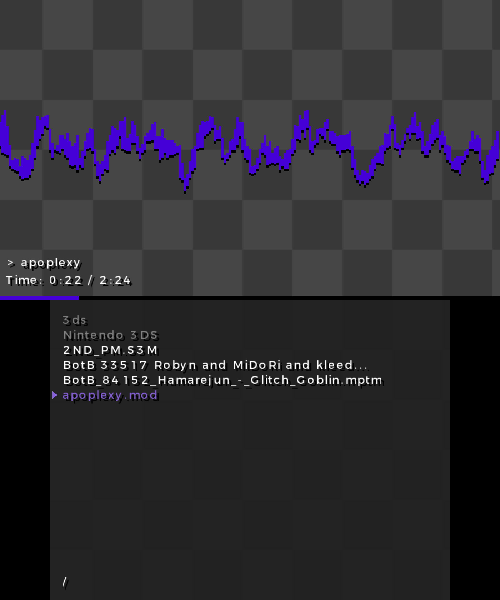

# ModPlayer3DS

Simple module player for 3DS

**Note: Modules with larger amount of channels might lag on old 3DS. Not much testing done on old 3DS, because I only have access to new 3DS consoles.**

## Controls
- Left, right: Rewind and fast-forward
- Up, down: Select file
- B: Pause
- A: Enter directory or play
- L: Change interpolation
- R: Change waveform